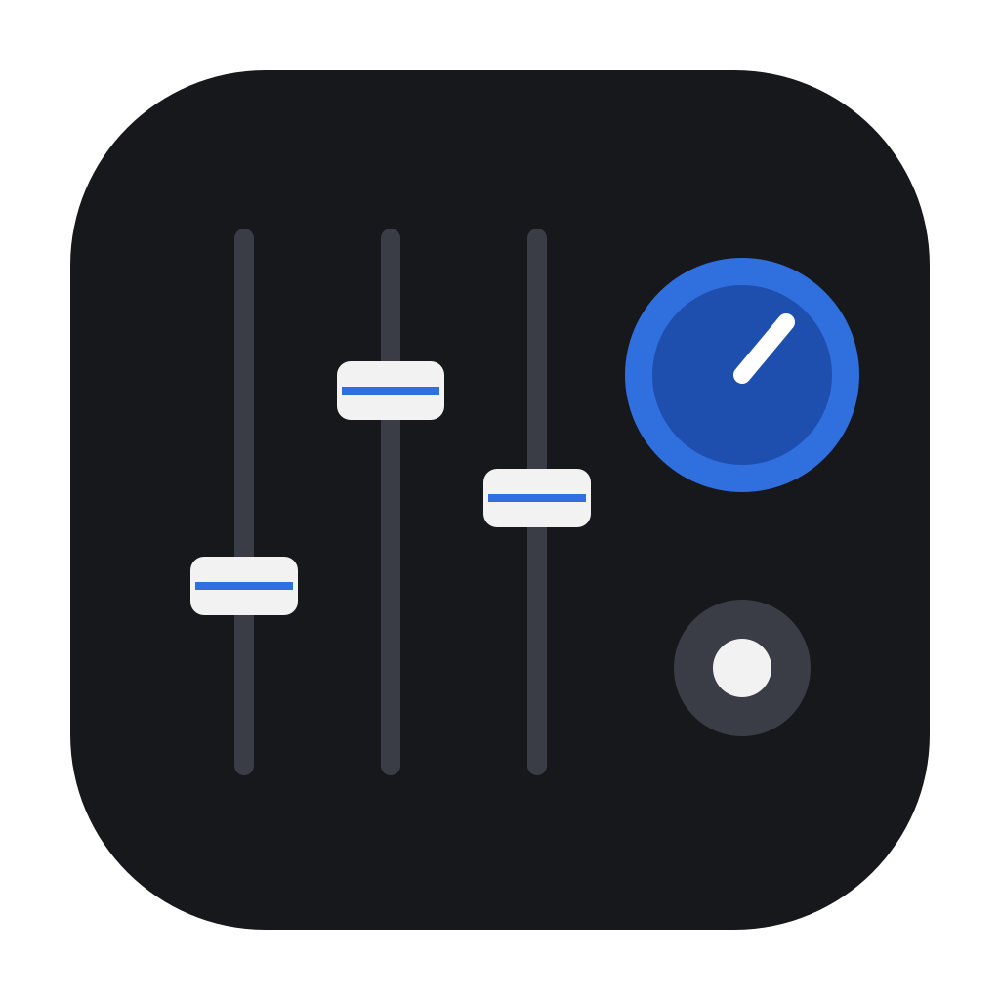
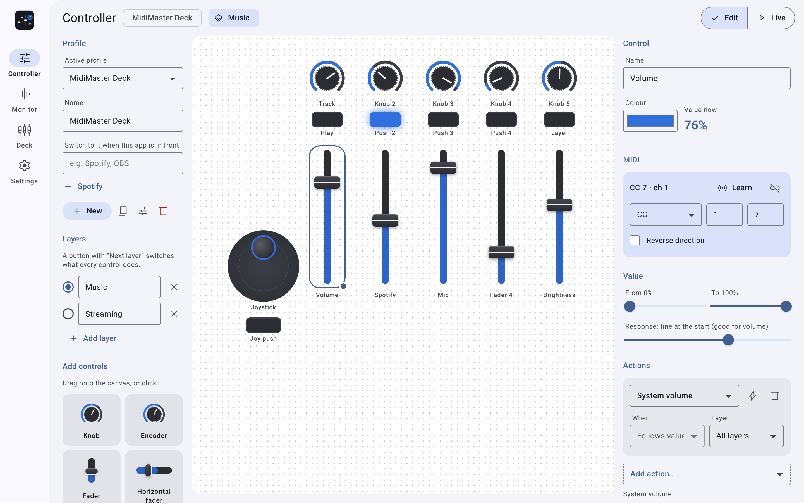
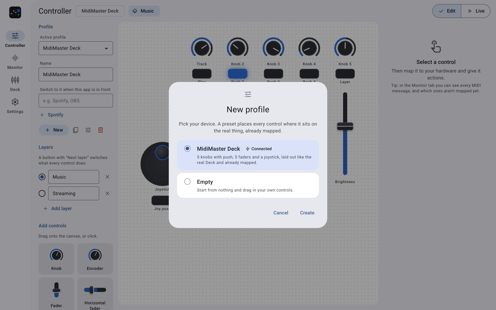
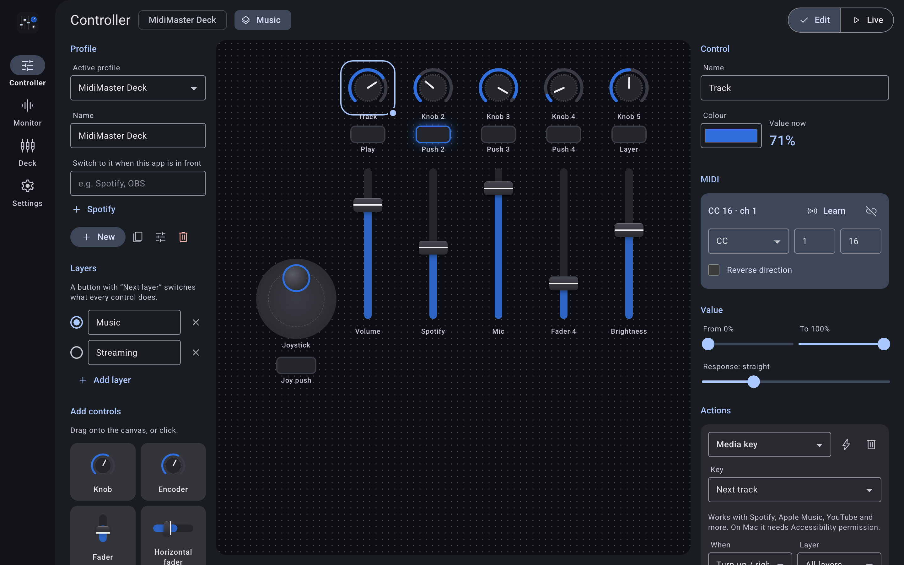
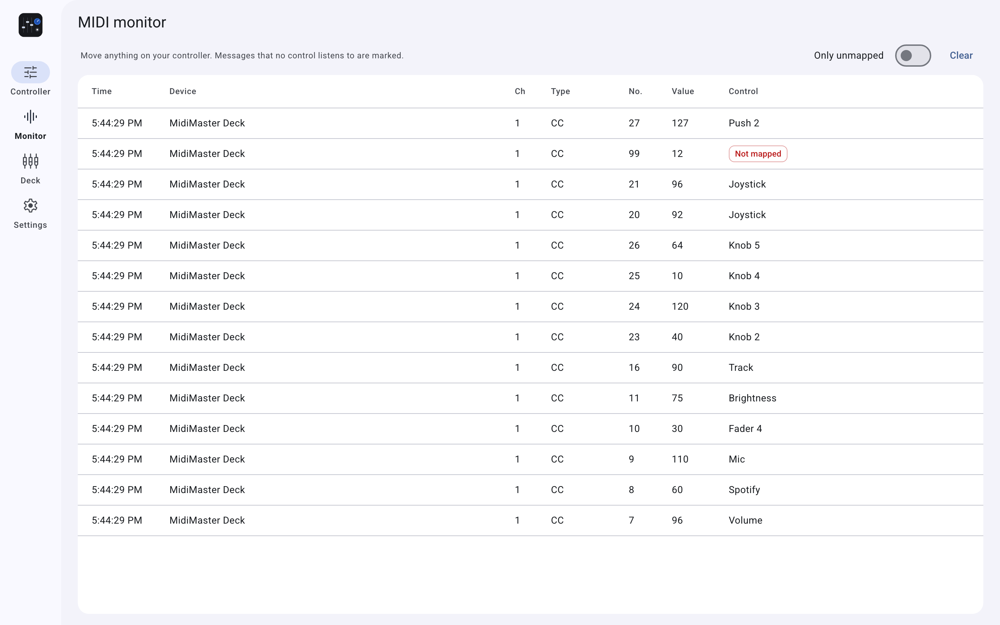
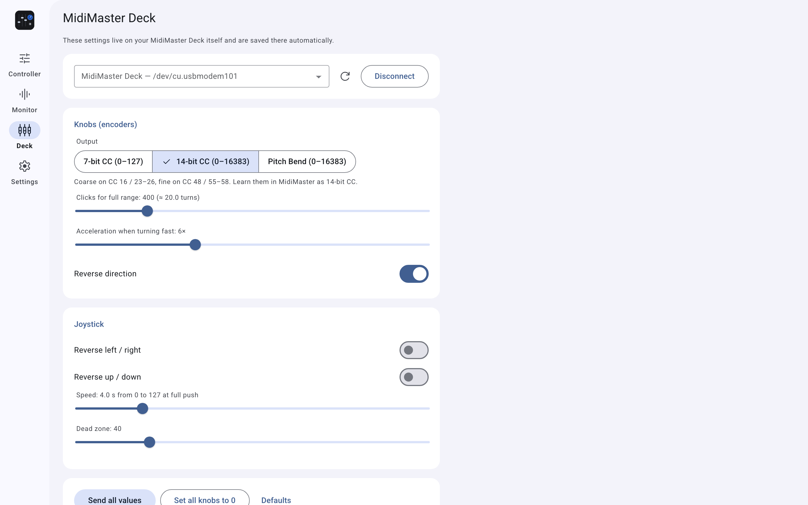
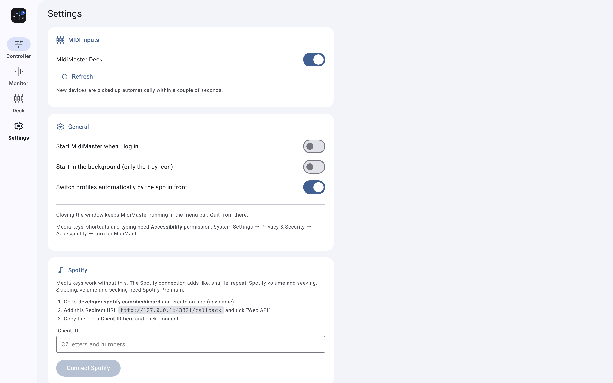

<p align="center">
  
</p>

<h1 align="center">MidiMaster</h1>

<p align="center">
  Build a picture of your MIDI controller, map every knob, fader, button and joystick,
  and use it to control your computer. Runs on <b>macOS</b> (Apple Silicon and Intel) and <b>Windows</b>.
</p>

<p align="center">
  
</p>

## Install

1. Open the [**latest release**](../../releases/latest).
2. Download the file for your computer:

   | Your computer | File to download |
   |---|---|
   | Mac with Apple Silicon (M1, M2, M3, M4…) | `MidiMaster_<version>_macos_silicon.dmg` |
   | Mac with an Intel processor | `MidiMaster_<version>_macos_intel.dmg` |
   | Windows 10 or 11 | `MidiMaster_<version>_windows_setup.exe` (or `_windows.msi`) |

   The `.app.tar.gz` files and `latest.json` in a release are for the built-in updater; you don't need them.

   Not sure which Mac you have? Apple menu → *About This Mac*: “Chip: Apple M…” means Apple Silicon, “Processor: Intel…” means Intel.

3. Install it:
   - **Mac:** open the `.dmg` and drag **MidiMaster** into **Applications**.
   - **Windows:** run the installer.

### First launch

MidiMaster isn't code-signed yet, so your computer asks once whether you trust it.

- **Mac:** open MidiMaster from Applications. If macOS says it can't be opened, go to
  System Settings → Privacy & Security, scroll down and click **Open Anyway** next to MidiMaster.
  (On older macOS versions: right-click MidiMaster → *Open* → *Open*.)
- **Windows:** if you see “Windows protected your PC”, click **More info** → **Run anyway**.

### Updates

From version 0.2.0 on, MidiMaster updates itself. When a new version is out, a popup offers it:
click **Update** and MidiMaster downloads it, installs it and restarts. It checks when it starts and
every few hours; you can also check in **Settings → About and updates**.
Updates are signed, and MidiMaster only installs updates signed with the project's key.

### Permissions (Mac)

Media keys, keyboard shortcuts and typing text need **Accessibility** permission:
System Settings → Privacy & Security → Accessibility → turn on **MidiMaster**.

### Getting started

1. Plug in your controller. The **New** button offers a **device preset**: pick **MidiMaster Deck** and every
   control is placed and mapped like the real Deck. For any other controller, start empty, drag in controls
   and use **Learn**.
2. Select a control and add actions (volume, media keys, Spotify, OBS, shortcuts…).
3. Close the window: MidiMaster keeps running in the menu bar / system tray. Turn on
   *Start MidiMaster when I log in* in Settings to have it always ready.

## What it does

- **Device presets:** pick *MidiMaster Deck* and every control is placed where it sits on the real Deck, already mapped. Or start empty.
- **Builder:** drag knobs, encoders, faders (vertical and horizontal), joysticks, buttons, pads and text onto a canvas; move, resize, name and colour them. Drag the empty canvas to move around.
- **MIDI Learn:** select a control, click *Learn*, move the real thing. Supports CC, 14-bit CC, pitch bend and notes.
- **Live view:** every control follows the hardware and lights up when it moves. Unmapped controls are outlined; the *MIDI monitor* lists every message and which ones nothing listens to.
- **Actions:** system volume, mute, mic volume and mute, per-app volume (Windows), next output device (Mac), screen brightness, media keys, Spotify (play/pause, next, previous, like, shuffle, repeat, volume, jump, scrub), keyboard shortcuts, typing text, opening apps, files and websites, running commands, OBS (scenes, mute, source volume, record, stream).
- **Triggers:** follow the value, press, release, long press, double press, turn up, turn down.
- **Layers:** one button switches what all controls do.
- **Profiles:** switch automatically by the app in front.
- **MidiMaster Deck settings:** the Deck's own settings (output mode, resolution, acceleration, directions, joystick), stored on the Deck.
- Runs in the menu bar / system tray with a one-colour icon; optional start at login. Light and dark mode.

## Screenshots

| | |
|---|---|
|  |  |
| **Device presets:** start from the MidiMaster Deck layout | **Dark mode:** a knob that skips tracks when turned |
|  |  |
| **MIDI monitor:** every message, and which ones aren't mapped | **MidiMaster Deck:** settings stored on the Deck itself |

<p align="center">
  <br>
  <b>Settings:</b> MIDI inputs, start at login, Spotify and OBS
</p>

## Spotify

Media keys work for any player without logging in. The Spotify connection adds the extra actions:

1. Create an app at <https://developer.spotify.com/dashboard>.
2. Add the redirect URI `http://127.0.0.1:43821/callback` and tick *Web API*.
3. Paste the Client ID in MidiMaster → Settings → Spotify, then *Connect*.

Playback control through the Web API needs Spotify Premium.

## OBS

MidiMaster connects to OBS automatically: it reads the port and password from OBS's own settings,
the way other control apps do. You only have to switch the server on once:
OBS → Tools → WebSocket Server Settings → *Enable WebSocket server*.
In OBS actions you can then pick your scenes and sources from a list.

## Limits

- Per-app volume is Windows-only (macOS has no API for it without an extra audio driver).
- Switching the output device is Mac-only for now.
- External monitor brightness works on Windows when the monitor supports DDC/CI; on Mac only built-in and Apple displays.

## Development

Needs Node 20+ and Rust.

```bash
npm install
npx tauri dev
```

```bash
cd src-tauri && cargo test --lib
```

- Code: `src-tauri/src` (Rust: MIDI, mapping engine, actions, Spotify, OBS, serial) and `src` (Svelte interface).
- Settings live in `config.json` in the app's config folder.
- `dev/mock.html` runs the interface in a browser with a fake backend (`npx vite`, then open `/dev/mock.html`;
  add `?demo=1` for the screenshot demo).

### Releases

Every push to `main` builds all three versions with GitHub Actions (download them from the run's *Artifacts*).
To publish a release, push a version tag:

```bash
git tag v0.1.0 && git push origin v0.1.0
```

The workflow builds Apple Silicon, Intel and Windows, names the files after the platform
(`macos_silicon`, `macos_intel`, `windows`), and publishes them in one GitHub release together with
`latest.json`, the update feed the app reads.

Update signing needs the private key as repository secrets (`TAURI_SIGNING_PRIVATE_KEY` and
`TAURI_SIGNING_PRIVATE_KEY_PASSWORD`). The matching public key is in `src-tauri/tauri.conf.json`.
Keep a backup of the private key: without it, installed apps can't receive updates.
